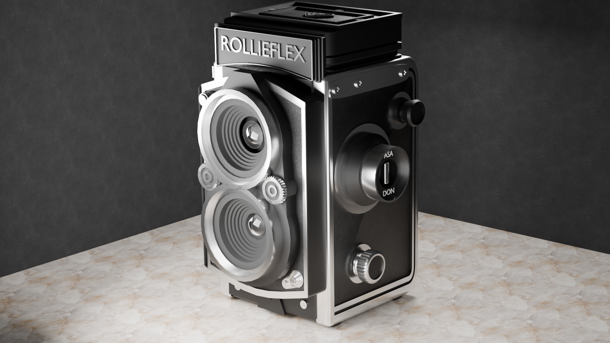
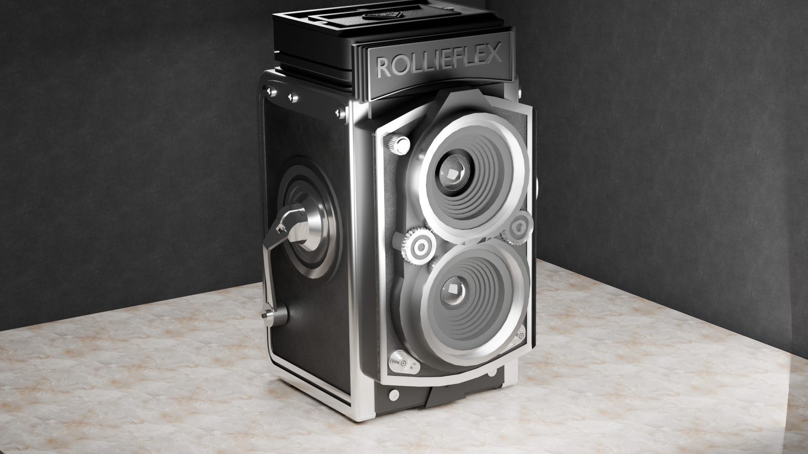
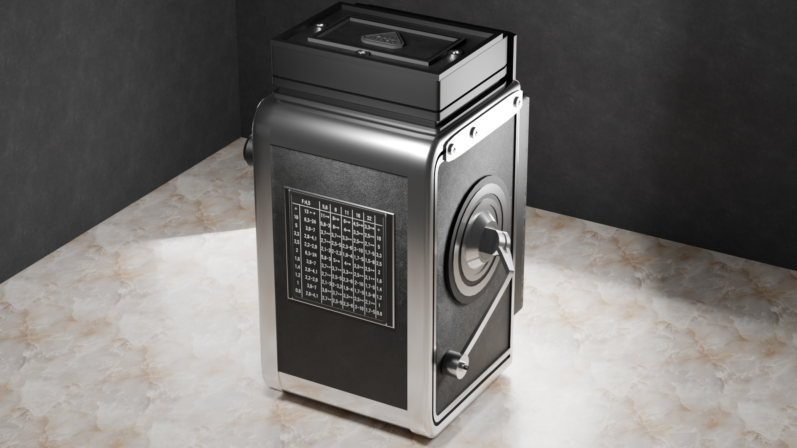
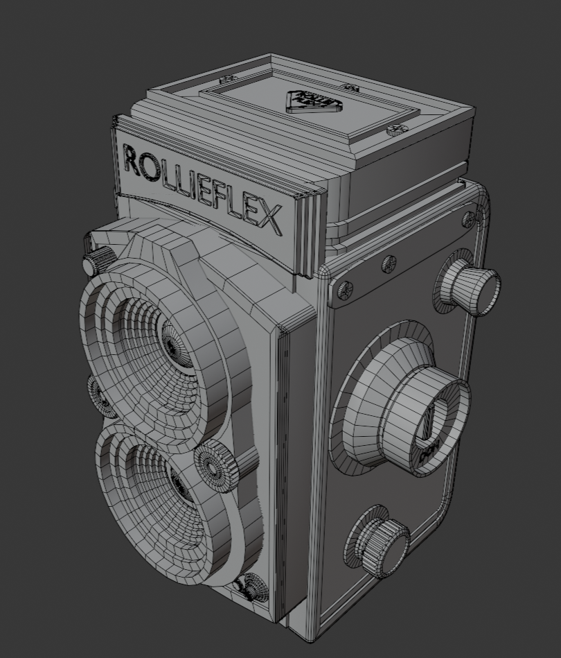

# Rolleiflex TLR Camera — Blender

A 3D model of a Rolleiflex twin-lens reflex camera, modelled, textured and rendered in Blender as a university project (MS Visual and Spatial Computing, KFUPM).



## Renders

| Crank side | Back with exposure table |
| --- | --- |
|  |  |

| ASA/DIN dial close-up | Wireframe |
| --- | --- |
|  |  |

## Modelling

- Built from primitives with Extrude (`E`), Inset (`I`), Loop Cuts (`Ctrl+R`) and Bevel (`Ctrl+B`) for the stamped-metal edges.
- Phillips-head screws cut with a Boolean modifier (Difference) and a plus-shaped cutter.
- Parts such as the ROLLEIFLEX logo shield organised with Join (`Ctrl+J`) and Separate (`P` > By Selection).
- Clean-up: applied scale (`Ctrl+A`), Merge by Distance, Origin to Geometry.

## Materials

- First pass: matte black, black plastic, silver chrome and lens glass, built with the Principled BSDF (Roughness, Metallic, Transmission).
- Final pass: leather and chrome materials from BlenderKit.

## Render setup

| Setting | Value |
| --- | --- |
| Engine | Cycles, with denoising |
| Camera | 85 mm, depth of field on |
| Lighting | Three-point setup with area lights (key, fill, rim) |
| Scene | Marble floor, dark textured wall |

## Known issues

- Lens interiors render as flat grey.
- One bright light patch on the floor.
- Slight grain in the dark leather areas.

## Files

```
rolleiflex.blend    Blender scene
renders/            Final renders and wireframe
```

To open the scene, download `rolleiflex.blend` and open it in Blender. The leather and chrome materials come from BlenderKit, so the add-on may be needed if textures show as missing (pink).

## Credits

- Leather and chrome materials: [BlenderKit](https://www.blenderkit.com/)
- Rolleiflex is a trademark of its respective owner. This is a student modelling exercise and is not affiliated with or endorsed by the brand.

## Author

Fahad Rehman
